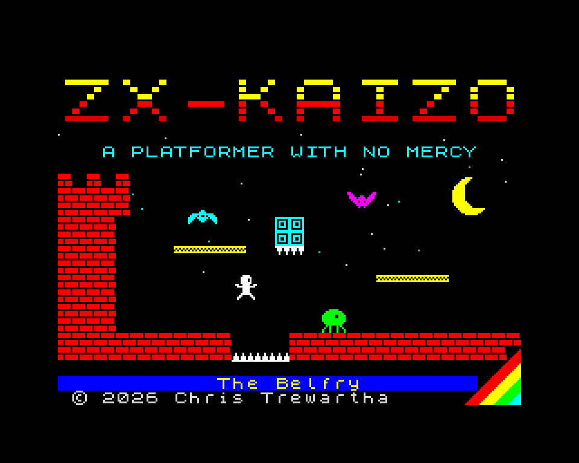
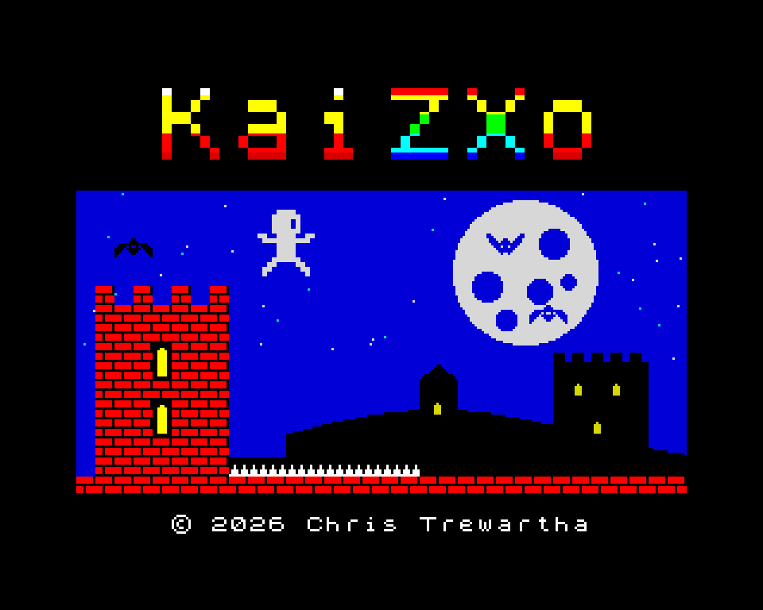

# KaiZXo



A tough, precise platformer for the 48K ZX Spectrum, written in C and Z80
assembly with z88dk. Climb, fall and wall-jump through 15 levels of a
haunted castle, from the Kitchen up into the Eye of the Storm, past spikes,
beetles and bats. Each level is one screen: start on the left and reach the
flashing exit in the right-hand wall. Lives are unlimited. When you die you
go back to the start of the screen.

Each level also hides a trophy, off the way to the exit and harder to get
to. Pick it up, then reach the exit to win it; die on the way and it goes
back to its place. The cup on the status line flashes while you carry one,
and the ending shows how many you won.

At the start screen, press any jump key to begin.

## Controls

| Action | Keys | Kempston |
| --- | --- | --- |
| Left / right | `O` / `P` | left / right |
| Jump | `Q`, `Space` or `M` | up or fire |
| Drop through a platform | hold `A` | hold down |
| Skip to the next level | `N` | |

The Kempston interface is detected automatically. Keyboard and joystick work
together.

## What's in it

- **Tight movement.** Fixed-point physics at 50Hz, with acceleration, skids
  and air control. Jump height depends on how long you hold the button, and
  you hang for a moment at the top of a full jump.
- **Forgiving timing.** Coyote time lets you jump a few frames after running
  off a ledge. Jump buffering remembers a press made just before landing.
- **Wall slides and wall jumps.** Push into a wall to slow your fall, then
  kick off it.
- **One-way platforms** you can jump up through and drop down through.
- **Spikes and enemies.** Walkers patrol the floors and flyers patrol the
  air. The hurt boxes are smaller than the sprites, so grazes don't kill.
- **Hard from the start, then harder.** The first eight levels mix pits,
  spikes, wall-jump shafts and enemies. The last seven need near-perfect
  play: hops over walkers under ceiling spikes, long jumps between single
  blocks, wall jumps past spiked walls, and landings on one-way platforms
  with spikes just above them.
- **A chill soundtrack.** A three-voice lounge loop plays on the AY chip of
  128K machines (or a 48K with an AY interface). A plain 48K plays without
  music.
- **Close to the metal.** The keyboard and joystick ports are read directly.
  A custom IM2 interrupt handler times the frames. Sprites are drawn in
  assembly, top to bottom and a line at a time, so none vanish ahead of the
  beam. The logic catches up after a slow frame.

## Building

You need:

- [z88dk](https://z88dk.org/) with SDCC, with `zcc` on your `PATH`
- PowerShell, which converts the level and sprite data
- [Fuse](https://fuse-emulator.sourceforge.net/) or any other Spectrum
  emulator, to play it

In VS Code, **Build Spectrum TAP** is the default build task and **Run in
Fuse** is the default test task. From a shell:

```sh
powershell -NoProfile -ExecutionPolicy Bypass -File tools/build_data.ps1
zcc +zx -vn -compiler=sdcc -SO3 -m -Isrc -Ibuild/gen \
    src/main.c src/player.c src/enemy.c src/room.c src/hud.c src/render.c src/sprites.c src/title.c src/music.c \
    build/gen/rooms_data.c build/gen/sprite_art.c build/gen/title_scr.c build/gen/music_data.c \
    src/render.asm src/input.asm src/interrupts.asm src/sound.asm \
    -o build/game -create-app -Cz--audio -Cz--screen=data/loading.scr
fuse --machine 48 --auto-load --tape build/game.tap
```

The build writes `build/game.tap` for emulators and `build/game.wav` for a
real Spectrum.

### Loading on a real Spectrum

Connect your PC or phone's headphone socket to the Spectrum's **EAR** socket.
Type `LOAD ""` and press Enter. On a 128K machine, pick **Tape Loader**
instead. Then play `build/game.wav`. Loading takes about 3 minutes.
If it fails, try a different volume and turn off any audio effects or EQ.

## The Commodore 64 version: Kaiz64o

The same game for the C64, with the same 15 levels and exactly the same
physics: it compiles `src/player.c` and `src/enemy.c` unchanged. Everything
you see and hear is the C64's own:

- **Multicolour graphics.** Every level has its own colour scheme, from the
  warm brick of the Kitchen to the night sky over the towers and the storm
  at the top. The tiles join up: bricks with open air above them get a lit
  cap. Behind the play area is stonework or a starry sky, and the castle
  walls either side carry flickering torches.
- **Hardware sprites.** The climber is two sprites: a multicolour body with
  a hi-res black outline laid over it. Beetles, bats, the trophy and the
  dust and sparkle effects have a sprite each. A carried trophy floats over
  your head.
- **Raster splits.** The play area and the HUD each have their own palette,
  the title's message scrolls smoothly on its own split, and the screen
  shakes when you die. In the last four levels, lightning lights up the sky
  and thunder follows.
- **SID music.** The AY version's song is the intro, with a sweeping pulse
  bass through the resonant filter, a plucked electric piano and vibes with
  vibrato. Then a bar of drums picks up the pace into a fast main theme:
  kick and snare drums between a pumping bass, shimmering arpeggio chords
  and a stabbing pulse lead. Jumps, wall jumps, deaths, trophies and level
  clears all have sound effects.

Use a joystick in either port, or the same keys as the Spectrum.

You need [oscar64](https://github.com/drmortalwombat/oscar64) on your `PATH`,
and [VICE](https://vice-emu.sourceforge.io/) to play it (`x64sc` on your
`PATH`, and `c1541` from the same folder for the disk image). In VS Code, run
the **Build C64 PRG** or **Run in VICE** task. From a shell:

```sh
powershell -NoProfile -ExecutionPolicy Bypass -File tools/build_c64.ps1
x64sc -autostart build/kaiz64o.d64
```

The build writes `build/kaiz64o.prg` and a disk image, `build/kaiz64o.d64`.
Add `-Run` to the build to start VICE when it's done, and `-Start <n>` to
skip the title and start on level n, for testing.

The C64's own data is in `c64/data/`: [chars.txt](c64/data/chars.txt) holds
the character graphics (tiles, background, walls, HUD and logo pieces), and
[sprites.txt](c64/data/sprites.txt) the sprite art, drawn in multicolour
double-width pixels. The colour scheme for each level is the `themes` table
in [c64/src/gfx.c](c64/src/gfx.c).

The soundtrack is [c64/data/music.txt](c64/data/music.txt): SID instruments
(waveform, envelope, pulse width sweep, arpeggio chords, vibrato, filter,
and pitch drops for drums), then sections of step grids in the same style
as `data/music.txt`. The intro section takes its notes straight from
`data/music.txt`, so the two versions share that song. The title screen
starts the music from the intro again.

## The Amiga version: Kaizamigo (work in progress)

The same levels and physics again (`src/player.c` and `src/enemy.c` are
shared once more), zoomed in to twice the size on a smoothly scrolling
screen, the way 16-bit platformers looked. So far it has:

- **Dual playfield parallax.** The level is drawn in 16x16 tiles on the
  front playfield. Behind it, at half the speed, is a far castle wall with
  tall arched windows, or out on the towers, distant battlements with lit
  windows.
- **A copper sky.** The colour behind both playfields changes on every
  line, for a smooth gradient: dusk through the windows, sunset over the
  rooftops, and lightning flickering across it in the storm.
- **A colour scheme for every level**, and fades between them.
- **A 32x32 hero in 15 colours**, from four hardware sprites in two
  attached pairs. The frames are made from the C64 art: scaled up with
  Scale2x, then outlined and shaded, so there's still one source to edit.
- **Enemies drawn by the blitter** into a double-buffered playfield. They
  share each level's danger colour with the spikes: anything in that colour
  kills.
- **A fly-over.** At 2x a level no longer fits on the screen, so each one
  opens on the exit and glides back to the start. The camera then follows
  the hero, looking ahead the way they face. Fire skips the fly-over.
- **Paula music.** The C64's soundtrack, played from generated waveform
  and drum samples with the SID instruments' envelopes, pulse sweeps,
  arpeggios and vibrato. Sound effects have the fourth channel to
  themselves, so they never cut into the music.
- **A HUD** in the system font, on a screen of its own under the play area,
  and a title screen with a shining logo over the drifting towers.

Use a joystick in port 2: up or fire jumps, down drops through a platform.

It builds with the GCC that comes with the
[Amiga C/C++ Compile, Debug & Profile](https://marketplace.visualstudio.com/items?itemName=BartmanAbyss.amiga-debug)
VS Code extension. Run the **Build Amiga** task, or:

```sh
powershell -NoProfile -ExecutionPolicy Bypass -File tools/build_amiga.ps1
```

That writes `build/amiga/kaiz.exe` and a bootable disk image,
`build/amiga/kaiz.adf`, which runs on the free AROS ROM, so no Kickstart is
needed. To play it, drag the disk image onto
[vAmigaWeb](https://vamigaweb.github.io), pick AROS if it asks for a ROM,
and set port 2 to the keyboard (arrow keys and Space). With a Kickstart 1.3
ROM set in `.vscode/launch.json`, F5 in VS Code builds it and runs it in
the extension's WinUAE, with its debugger and profiler.

The level tiles are in [amiga/data/tiles.txt](amiga/data/tiles.txt), and
each level's colours are the `themes` table in
[amiga/src/video.c](amiga/src/video.c). The soundtrack is shared with the
C64: `tools/song.ps1` compiles [c64/data/music.txt](c64/data/music.txt) for
both.

## Making levels

All the levels are in one text file, [data/world.txt](data/world.txt), in
the order they're played. Each one has a name and its enemies, then the
screen drawn as 22 rows of 32 characters:

| Char | Tile |
| --- | --- |
| `#` | brick |
| `X` | block |
| `=` | one-way platform |
| `^` / `v` | floor / ceiling spikes |
| `E` | exit |
| `S` | player start |
| `T` | trophy (one per level) |

Sprites are 16x16 ASCII art in [data/sprites.txt](data/sprites.txt).
`tools/build_data.ps1` packs both files into C data under `build/gen/`, and
reports errors with file and line numbers. The comments at the top of
`world.txt` cover the format and the jump distances to design for.

To check that every level can be finished, run:

```sh
powershell -NoProfile -ExecutionPolicy Bypass -File tools/check_levels.ps1
```

It searches for a route frame by frame, using a copy of the player physics
in `tools/level_sim.cs`, with the enemies on their patrols. Each level is
solved twice: straight to the exit, and by way of its trophy. For each
route it reports how long it takes (for a level with no enemies, the
fastest possible) and how many frames each input can be held before it
changes and the route still works. It also reports the tightest jump: each
jump is tried a frame early and late, and let go of a frame early and late,
and the score is how many of those 9 ways still get through. Under 4/9 is
close to frame-perfect, which is fine for a trophy but not for the way to
the exit. Use `-Level <n>` to check one level, and `-Quick` to skip the
jump scores, which take most of the time.

To see the route the search finds, drawn over the map with each jump
lettered and scored, run `tools/show_route.ps1 -Level <n>` (add `-Trophy`
for the trophy route).

If you change the physics in `src/player.c`, change `level_sim.cs` to match.

## Music

The soundtrack is [data/music.txt](data/music.txt), written as a grid of
steps like a tracker: a note, `-` to hold it, or `.` for silence, for each
of the three voices. Each voice has a simple instrument: a starting volume
that fades to a floor. `build_data.ps1` turns it into note data and pitch
tables for the AY.
## Project layout

```
src/         game code: C, plus Z80 assembly for input, interrupts and drawing
data/        levels, sprite art, music, start screen and loading screen
c64/         the C64 version: its own code (c64/src), graphics and music (c64/data)
amiga/       the Amiga version: its own code (amiga/src) and tiles (amiga/data)
tools/       data converter, screen generators, web page, C64 and Amiga builds
docs/        README images
web/         web page template and the JSSpeccy emulator
deploy/      service and one-time setup for the web server
```

To show CPU use as coloured bars in the border, set `DEBUG_TIMING` to 1 in
`src/main.c`.

## The start screen

The start screen, [data/title.scr](data/title.scr), is a real Spectrum screen
with one ink and one paper colour per 8x8 cell. `tools/make_cover.ps1` draws
it from the game's own tiles and sprites and the ROM font. The script also
saves the same screen as [docs/cover.png](docs/cover.png) for this README.
The build compresses the screen with zx0, to under 1KB, and the game unpacks
it straight into screen memory. The game prints the blinking "PRESS SPACE TO
START" prompt itself.

Run the script again after changing it, or the tiles or sprites:

```sh
powershell -NoProfile -ExecutionPolicy Bypass -File tools/make_cover.ps1
```

The script reads the font from a 48K ROM image. By default it looks in
Fuse's install folder. Use `-Rom` to point it somewhere else.

## The loading screen

On tape, the game loads a picture first, [data/loading.scr](data/loading.scr),
which fills in line by line while the rest of the game loads underneath.
`tools/make_loading.ps1` paints it in the 16 Spectrum colours, then cuts each
8x8 cell down to the two colours the hardware allows. It warns about any cell
that held more than two colours, so you can move things until nothing clashes.
It also saves [docs/loading.png](docs/loading.png).



Run the script again after changing it:

```sh
powershell -NoProfile -ExecutionPolicy Bypass -File tools/make_loading.ps1
```

## Playing in a browser

The game can run in a web page, on the
[JSSpeccy 3](https://github.com/gasman/jsspeccy3) emulator. The page template
is [web/index.html](web/index.html). A copy of JSSpeccy 3.2 is in
`web/jsspeccy/`, under its GPL v3 licence.

```sh
powershell -NoProfile -ExecutionPolicy Bypass -File tools/build_web.ps1
powershell -NoProfile -ExecutionPolicy Bypass -File tools/serve_web.ps1
```

`build_web.ps1` puts the page, the emulator and the latest `build/game.tap`
into `build/web/`, which any static web server can serve. The tape's file
name includes a hash of it, so browsers never load an old build.
`serve_web.ps1` serves that folder on http://localhost:8080/, so you can try
it before deploying. Browsers won't run the emulator from a `file://` URL.
In VS Code, the **Build Web Page** and **Serve Web Page** tasks do the same.

The page runs the game on a 128K Spectrum, so the AY music plays. It starts
when you click the loading screen, because browsers only allow sound after a
click.

On phones and tablets, the page shows touch controls: a d-pad, plus JUMP,
DROP, START and SKIP buttons. Each one sends the emulator the same key events as
the keyboard. Turned sideways, the page shows just the game, with the
controls on either side. `build_web.ps1` also draws the site's icons from
the hero's jump sprite.

### The C64 version's page

`build_web.ps1` also puts Kaiz64o on the site, at `c64/`, so it needs a C64
build (`tools/build_c64.ps1`) as well. Its template is
[web/c64.html](web/c64.html), with the same layout and touch controls. It
runs on the [Tiny Emulators](https://floooh.github.io/tiny8bit/) C64 by
Andre Weissflog: a copy is in `web/tiny8bit/`, under the zlib and MIT
licences in its `LICENSE.txt`. The emulator includes the C64's ROMs.

The emulator runs in a frame, [web/tiny8bit/emu.html](web/tiny8bit/emu.html),
which loads the program and types `RUN`. The emulator only treats the arrow
keys and Space as held keys (as joystick 2): it types letter keys, so
holding one repeats it. So the frame swaps the game's keys O, P, Q, A and M
for those, and the touch buttons send the same. N goes through as typed.
The emulator also prints a frame counter along the bottom of its screen,
which the page hides under a black strip.

### Deploying

The page is live at https://kaizxo.christrewartha.com/. It's served from the
home server `scaramanga`, through the same Cloudflare tunnel as NFFL.

```sh
powershell -NoProfile -ExecutionPolicy Bypass -File tools/deploy_web.ps1
```

The **Deploy Web Page** task builds everything first, then runs this. The
script uploads `build/web/` over SSH into a new folder under
`~/kaizxo/releases/`, then switches the `~/kaizxo/site` link to it. It keeps
the last 5 releases. To roll back, point the link at an older one:
`ln -sfn releases/<time> ~/kaizxo/site`. It needs SSH key login to the
server.

On the server, `kaizxo.service` runs Python's built-in web server on
`127.0.0.1:8790`, and the tunnel sends the hostname there. To set that up the
first time, deploy once and then run this on the server:

```sh
sudo bash ~/kaizxo/setup_server.sh
```

It installs and starts the service, then adds the hostname to
`/etc/cloudflared/config.yml` and restarts the tunnel. It keeps a backup of the
old config. The DNS record came from
`cloudflared tunnel route dns <tunnel> kaizxo.christrewartha.com`.
